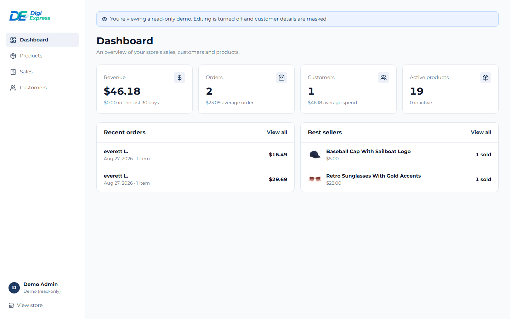
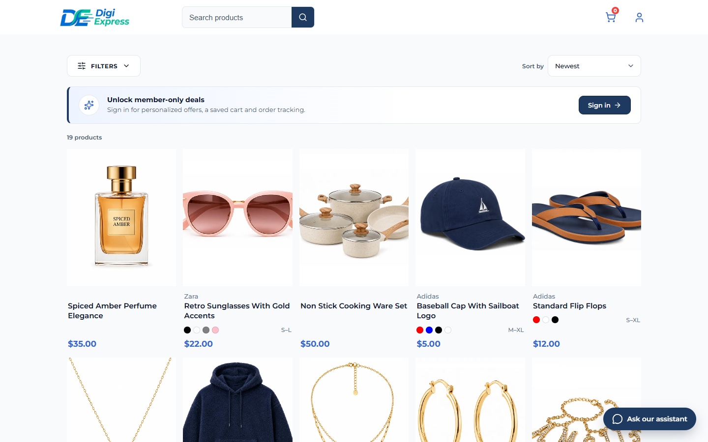
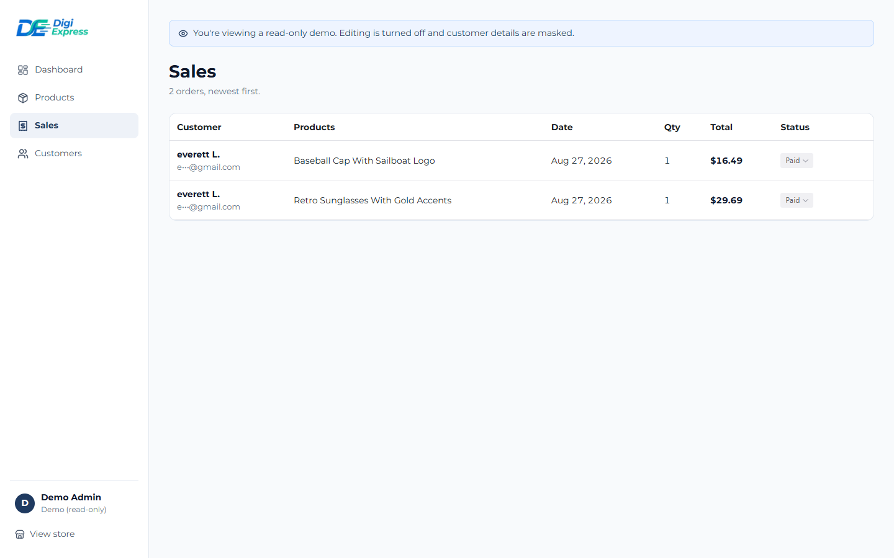
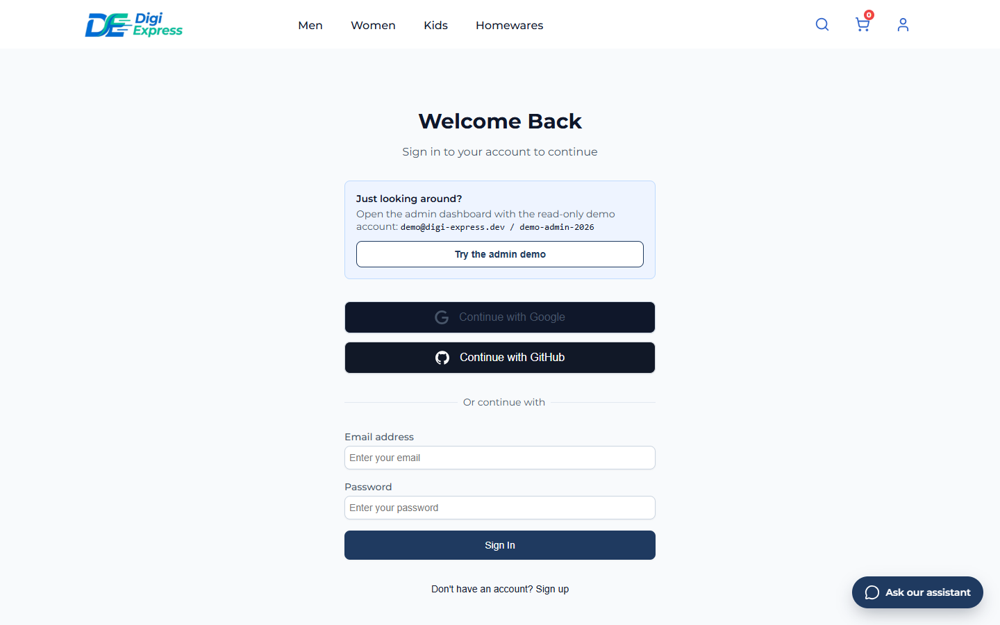

# Digi-Express

[](https://github.com/Everett911/digi-express/actions/workflows/ci.yml)

A full-stack fashion and homeware store built with the Next.js App Router.
Shoppers browse and search the catalogue, pay with Stripe, track their orders
and ask an AI shopping assistant for help. Admins manage products, orders and
customers from a dashboard.

**Live site:** <https://digi-express-alpha.vercel.app>

## Try the admin dashboard

No sign-up needed. On the [sign-in page](https://digi-express-alpha.vercel.app/auth),
press **Try the admin demo**, or sign in with:

| Email                   | Password          |
| ----------------------- | ----------------- |
| `demo@digi-express.dev` | `demo-admin-2026` |

The demo account is read-only: you can open every admin page, but the server
rejects changes, and customer names and emails are masked. To pay for a test
order, use the card `4242 4242 4242 4242` with any future expiry date and CVC.



| AI shopping assistant                                                                              | Catalogue with filters and search                                        |
| -------------------------------------------------------------------------------------------------- | ------------------------------------------------------------------------ |
|  |  |
| **Sales (as the demo account sees it)**                                                            | **Sign-in with one-click demo**                                          |
|                      |   |

## What I built

I built Digi-Express on my own to learn everything a real online store needs,
not only the frontend.

- **Catalogue and search**: filter by size, colour, brand, price and
  department, sort results, and get spelling-tolerant search ("snekers" finds
  sneakers). Filter options and counts come from the database.
- **Accounts**: email and password sign-up with email verification, plus
  Google and GitHub sign-in (Better Auth).
- **Cart and checkout**: one cart line per product variant (size and colour),
  a delivery option per line, and payment with Stripe Payment Elements. Totals
  are always calculated on the server from database prices.
- **Orders**: a Stripe webhook creates the order and emails a confirmation
  (Resend). Customers can view their orders and their status, and buy an item
  again.
- **Admin dashboard** (`/admin`): sales overview, product create, edit and
  hide (photos stored in Vercel Blob), order status updates and customer
  management. Every admin server action checks the session's role itself.
- **AI shopping assistant**: a chat window that finds products and shows them
  as picture cards, explains delivery options and, for signed-in customers,
  answers questions about their own orders. It runs on Gemini and calls the
  store's MCP tools instead of guessing.
- **MCP server** (`mcp/`): 21 tools, 6 resources and 6 prompts that let an AI
  client such as Claude Code search, report on and manage the store. Set
  `MCP_READ_ONLY=true` to leave out every tool that writes.

### Decisions worth a look

- **The server owns money.** Prices are whole cents, totals are recalculated
  from the database, and orders are created only by Stripe's signed webhook.
- **The chat can't see other people's orders.** It only gets four
  customer-safe tools, and the order tool takes the customer ID from the
  session, never from the model.
- **The chat can't run up a bill.** A per-minute and per-day rate limit is
  stored in Postgres (in-memory counters don't work across serverless
  instances), and only the last ten messages go to the model.
- **The public demo login is safe to publish.** It has its own `demo` role:
  pages render, actions reject it, customer details are masked, and Better
  Auth hooks stop anyone changing its password or profile (`lib/demo.ts`).

## Tech stack

Next.js 16 (App Router, React 19, React Compiler) · TypeScript · PostgreSQL
with Prisma 7 · Better Auth · Stripe · Resend · Zod · Radix Themes · Model
Context Protocol SDK · Gemini API · Vitest · GitHub Actions

## Tests

38 unit tests cover checkout totals and order lines, cart validation, price
mapping, the chat's tool-calling loop, the storefront MCP tools and the demo
account rules. GitHub Actions runs the type check, lint, format check and
tests on every pull request and every push to `master`.

```bash
npm test
```

## Run it locally

Requires Node.js 20+ and a PostgreSQL database.

```bash
npm install
cp .env.example .env.local   # then fill in the values below
npx prisma db push           # create the tables
npx prisma db seed           # add the delivery options and the demo account
npm run dev
```

Open <http://localhost:3000>. The seed creates the read-only demo account
above. For full admin access, sign up, then set your user's `role` to `admin`
in the database. The role can't be set through the app.

### Environment variables

| Variable                                   | Purpose                                                                    |
| ------------------------------------------ | -------------------------------------------------------------------------- |
| `DATABASE_URL`                             | PostgreSQL connection string                                               |
| `BETTER_AUTH_SECRET`                       | Secret used to sign sessions                                               |
| `BETTER_AUTH_URL`                          | Site URL, for example `http://localhost:3000`                              |
| `NEXT_PUBLIC_SERVER_URL`                   | Site URL Stripe returns to after payment                                   |
| `GOOGLE_CLIENT_ID`, `GOOGLE_CLIENT_SECRET` | Google sign-in                                                             |
| `GITHUB_CLIENT_ID`, `GITHUB_CLIENT_SECRET` | GitHub sign-in                                                             |
| `STRIPE_SECRET_KEY`                        | Stripe API key (use a test key)                                            |
| `NEXT_PUBLIC_STRIPE_PUBLIC_KEY`            | Stripe publishable key                                                     |
| `STRIPE_WEBHOOK_SECRET_KEY`                | Signing secret for `/api/webhooks/stripe`                                  |
| `RESEND_API_KEY`                           | Sends verification and order emails (optional locally: emails are skipped) |
| `EMAIL_FROM`                               | Sender address, for example `Digi Express <orders@example.com>`            |
| `BLOB_READ_WRITE_TOKEN`                    | Vercel Blob store for product photos uploaded in the admin                 |
| `GEMINI_API_KEY`                           | Runs the shopping assistant (the chat is turned off without it)            |
| `GEMINI_MODEL`                             | Optional. Defaults to `gemini-3.5-flash`                                   |
| `REVALIDATE_SECRET`                        | Lets the MCP server refresh cached store pages after it changes data       |
| `MCP_READ_ONLY`                            | `true` hides the MCP tools that write to the database                      |

To receive Stripe webhooks locally:

```bash
stripe listen --forward-to localhost:3000/api/webhooks/stripe
```

### Use the MCP server

`.mcp.json` registers the server for Claude Code. To explore it in the MCP
Inspector instead:

```bash
npm run mcp:inspect
```

## Scripts

| Command               | What it does                                        |
| --------------------- | --------------------------------------------------- |
| `npm run dev`         | Start the development server                        |
| `npm run build`       | Generate the Prisma client and build for production |
| `npm run lint`        | Lint with Vite+                                     |
| `npm test`            | Run the unit tests (Vitest)                         |
| `npm run mcp:dev`     | Start the MCP server over stdio                     |
| `npm run mcp:inspect` | Open the MCP server in the MCP Inspector            |

## Project structure

```
lib/                 server code: auth, Prisma, Stripe, email, data access
  ai/chat.ts         the shopping assistant: Gemini + in-memory MCP client
  db/                queries and server actions (cart, products, orders)
  checkout.ts        cart totals and order line building
  demo.ts            the read-only demo account
  rateLimit.ts       Postgres-backed rate limiter
mcp/                 MCP server: tools, resources and prompts
prisma/              schema and seed script
src/app/(main)/      storefront: home, products, checkout, orders, sign-in
src/app/admin/       admin dashboard and its server actions
src/app/api/         auth routes, chat, revalidation and the Stripe webhook
src/components/      shared UI, including the ShoppingChat widget
src/schemas/         Zod schemas and shared types
```
